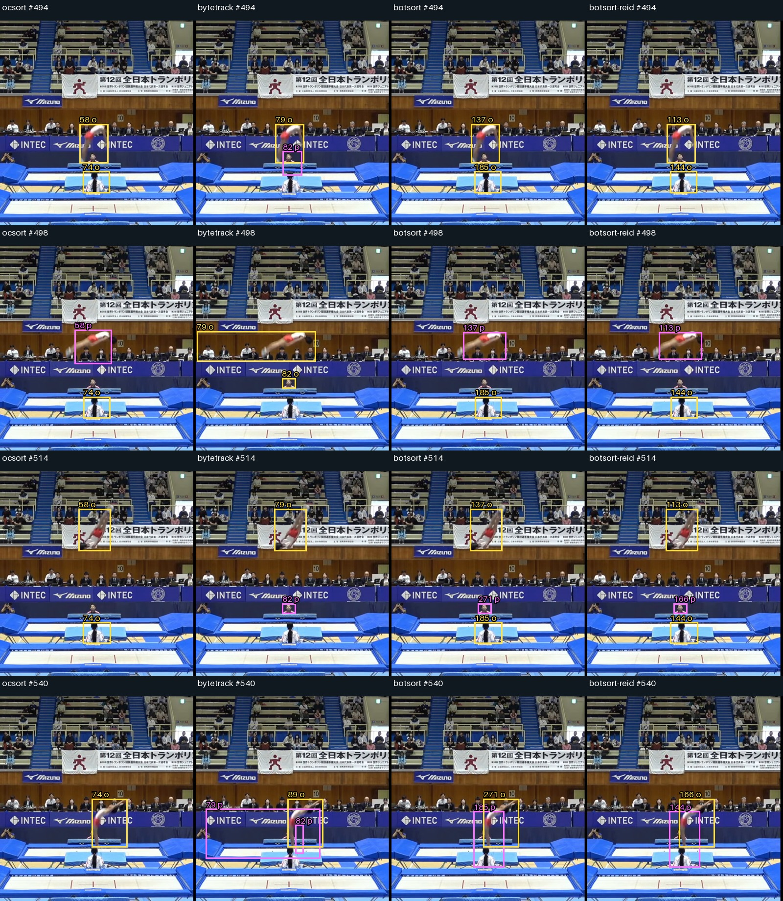
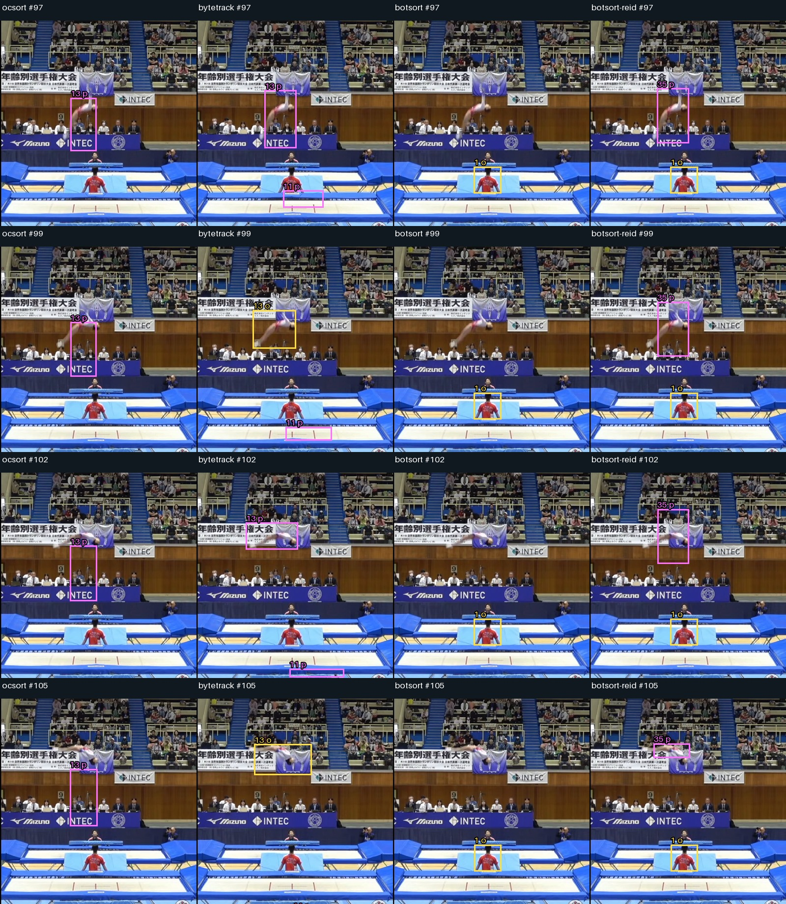

# Revisió provisional de la comparació d’identitat v1

**Conclusió:** BoT-SORT és el millor punt de partida dels perfils comparats
per reduir fragmentació als instants disponibles. **L’aportació de ReID és
petita i irregular amb aquesta entrada, i cap perfil manté una identitat pura
del gimnasta en tots els casos inspeccionats.** ReID també transfereix IDs a
assistents. No es declara guanyador validat ni es canvien defaults.

Revisió de l’agent Codex, 2026-11-20, sense validació humana nova.
L’estudi continua obert. Aquest directori conserva el resum petit i dos
contraexemples visuals; les traces, MP4 i observacions completes queden a
`runs/calibration/identity-continuity-review-v1/`. El run original és
`runs/calibration/identity-continuity-v1/` i no s’ha modificat.

## Què s’ha comprovat i què s’ha revisat

- Verificats **47 artefactes** del marcador original, incloent MP4, i els
  hashes dels fitxers de codi enregistrats: sense discrepàncies en iniciar
  aquesta revisió. Recalculada la igualtat exacta de candidates entre
  auditoria i quatre perfils en els **2.610 frames**. Traces completes:
  930 + 1.110 + 570, sense frames font absents. Cap inferència de detector,
  tracker o recovery nova durant l’anàlisi.
- Diagnòstics geomètrics en les **240 referències disperses** existents:
  205 visibles, 34 ambigües i una oclosa. Continuen sent IA provisionals.
- Inspecció visual de **109 frames originals únics** amb caixes/IDs:
  mostreig cada 60 frames, exemples dirigits i cinc finestres curtes contínues.
  Inspecció amb làmines estàtiques, no visionat temporal exhaustiu dels MP4.
- Dins d’aquests, revisió de candidates **frame a frame en 46 instants**:
  AGE1 [440,448), [490,498); AGE2 [522,534); AGE3 [90,99), [250,259).
  S’han desat decisions explícites per aquests frames, 63 registres manuals
  d’actor/frame/perfil i sis exemples de transferència amb límits temporals
  acotats, sense inventar-ne la durada exacta.

**No s’ha completat l’anotació de les 1.620 frames de les finestres del
protocol.** Les 46 frames dirigides són una anàlisi de fallades, no una
mostra representativa. No hi ha taxa exhaustiva de transferències, llargada
validada de fragments purs, ni IDF1/HOTA/MOTA global. Un assistent o jutge
pot entrar en una caixa que també conté el gimnasta: el solapament no resol
la identitat. No s’infereixen etiquetes d’actor només de l’assignació.

## Continuïtat entre anotacions: criteri acordat el 2026-11-21

Totes les referències visibles del gimnasta d’un vídeo reben el mateix
`subject_id` estable `<case_id>:gymnast` a la capa d’avaluació derivada.
No es modifiquen originals ni es converteixen en validació humana.
Per cada parell d’anotacions visibles consecutives, un ID de tracker compartit
als dos extrems compta com a continuïtat correcta entre anotacions.

Hi ha **202 parells**: 66, 70 i 66 per vídeo. S’exclouen anotacions
ambigües/ocloses; si són entremig, el parell cobreix un interval més llarg.
Un extrem visible sense observació compatible queda com a buit: no se salta
per buscar el match següent. Les prediccions no substitueixen observacions.

| Perfil | Mateix ID / parells amb observació als dos extrems | Continuïtat condicionada | Canvi d’ID | Parells amb algun extrem sense observació compatible |
| --- | ---: | ---: | ---: | ---: |
| OC-SORT | 88/103 | 85,4% | 15 | 99 |
| ByteTrack | 100/116 | 86,2% | 16 | 86 |
| BoT-SORT | **109/119** | **91,6%** | 10 | 83 |
| BoT-SORT + ReID | 107/117 | 91,5% | 10 | 85 |

Sobre tots els parells visibles, incloent buits: continuïtat acreditada en
**88/202, 100/202, 109/202 i 107/202**, respectivament. Els buits no es
reetiqueten com a canvis d’ID ni com a continuïtat correcta. Els denominadors
condicionats difereixen perquè els perfils observen extrems diferents;
el denominador 202 conserva l’abast comú.

La correspondència anotació→track encara usa IoU≥0,5 sobre referències
provisionals. Amb geometria permissiva: 92/108, 105/125, 113/123 i 112/123.
No hi ha un únic ID que cobreixi tots els extrems observats de cap vídeo
amb cap perfil. Amb duplicats, cada parell pot compartir un ID diferent;
la intersecció global es comprova separadament.

Aquesta mètrica respon a estabilitat entre anotacions disperses i no exigeix
anotacions denses. No afirma què passa als frames intermedis: un ID podria
anar a un assistent i tornar. Les transferències visuals es mantenen com
a error separat. La qualitat provisional de la correspondència als extrems
també continua explícita.

[Recompte nou per vídeo i parells](endpoint-continuity.json). Detall local:
`runs/calibration/identity-endpoint-review-v1/pairs.jsonl`, amb frames,
conjunts d’IDs i estat de cada parell. Recalculat amb `analyze_identity.py`
en una sortida nova, sense executar models. Set tests de diagnòstic inclouen
buits anotats, canvis d’ID i duplicats.

**Aclariment dels 30 casos:** 179−149 són instants amb candidata compatible
però sense observació compatible del tracker. Separadament, 205−179=26
referències visibles no tenen candidata amb IoU≥0,5; encara podrien tenir
una caixa parcial útil que no superi aquest llindar.

## Disponibilitat de candidates

Entrada confirmada: YOLOv8m 0,001 enregistrat, preparació representativa
actual, zona central soft i 12 candidates per frame. Els quatre perfils
reben la mateixa geometria, score, procedència i ordre.

Sobre les 205 referències IA visibles hi ha candidata amb IoU≥0,5 en
**179/205** frames. Si s’admet cobertura de referència≥25% i almenys el
50% de la candidata dins la referència, són **189/205**. Són dos diagnòstics
geomètrics, no percentatges de disponibilitat útil validada.

La inspecció dirigida selecciona almenys una candidata útil en **45/46**
frames; les alternatives no s’han anotat exhaustivament. A AGE3 #97 no
s’observa candidata preparada útil. La revisió nova no ha inspeccionat
exhaustivament els originals YOLO d’aquest frame; l’absència ja estava
documentada a l’estudi anterior. Es conserva `raw_reviewed:false`, sense
convertir l’antecedent en una validació nova del detector.

A AGE2 #525, #527 i #531 hi ha candidates útils de scores aproximats
**0,002, 0,006 i 0,004**. Les caixes són a l’entrada preparada, però queden
per sota de 0,02 i de 0,10. La manca d’observació és d’admissió/associació,
no prova d’absència de candidata. A #529 una regió ampla encara permet
localitzar el gimnasta, tot i fallar el diagnòstic permissiu contra la
referència. Això confirma que no s’ha d’usar el llindar geomètric per
decidir automàticament si s’ha perdut la persona.

## Associació i fragmentació als instants dispersos

Taula principal amb **IoU≥0,5**. `Observacions/candidates` és el nombre de
frames amb alguna observació geomètricament compatible dividit pels frames
amb candidata compatible. Els canvis són el mínim possible entre conjunts
d’IDs als matches dispersos, saltant buits; **no són canvis reals comptats
frame a frame**. No s’han filtrat per identitat humana.

| Vídeo | OC-SORT | ByteTrack | BoT-SORT | BoT-SORT + ReID |
| --- | --- | --- | --- | --- |
| AGE1: observacions/candidates | 52/64 | 54/64 | 56/64 | 56/64 |
| AGE1: canvis mínims dispersos | 14 | 16 | 9 | 8 |
| AGE2: observacions/candidates | 45/58 | 48/58 | 48/58 | 48/58 |
| AGE2: canvis mínims dispersos | 14 | 13 | 8 | 8 |
| AGE3: observacions/candidates | 42/57 | 47/57 | 45/57 | 45/57 |
| AGE3: canvis mínims dispersos | 8 | 9 | 9 | 8 |
| Total: observacions/candidates | **139/179** | **149/179** | **149/179** | **149/179** |
| Suma de canvis mínims per vídeo | 36 | 38 | 26 | 24 |
| Frames amb predicció compatible i sense observació compatible /205 | 26 | 15 | 18 | 22 |

Amb el diagnòstic permissiu, observacions/candidates totals:
OC-SORT **145/189**, ByteTrack **158/189**, BoT-SORT **156/189**,
ReID **157/189**. Les sumes de canvis mínims són 37, 42, 27 i 25.
El canvi de llindar conserva la tendència general, però altera l’ordre
de cobertura: no hi ha una victòria universal de ReID.

Respecte de BoT-SORT sense ReID, l’aparença aporta **zero observacions
addicionals** al criteri estricte i una al permissiu; redueix en dos la
suma dels límits inferiors de canvis. Aquest guany és modest i no resol
la contaminació d’identitat que mostren les imatges següents.

## Continuïtat d’identitat: contraexemples visuals

### AGE1: els IDs s’intercanvien amb l’assistent

Al #415, BoT-SORT sense ReID segueix el gimnasta amb **137**, i l’assistent
blanc de primer pla amb **185**. Al #445, **137** és a l’assistent i
**185** al gimnasta. ByteTrack també intercanvia **68** i **57** entre
#427 i #445. ReID evita aquest intercanvi concret amb **144**, però ja
havia fragmentat **78 → 144** entre #415 i #427.

Al contacte posterior, ReID té **144** al gimnasta i **113** a l’assistent
al #480; al #494 s’han intercanviat. BoT-SORT sense ReID fa l’intercanvi
**185 ↔ 137**; OC-SORT **74 ↔ 58**. Al #540 OC-SORT torna a posar **74**
al gimnasta: reutilitzar el número no demostra un fragment d’identitat pur.
Les caixes mixtes al contacte s’han marcat com a ambigües quan cal.



Columnes: OC-SORT, ByteTrack, BoT-SORT, BoT-SORT + ReID.
Groc: observació; magenta: predicció. Només s’hi dibuixen IDs seleccionats
per al diagnòstic. Les caixes i els píxels són els enregistrats, amb retall
de visualització; no s’ha executat de nou cap tracker.

Al #498 OC-SORT, BoT-SORT i ReID només prediuen el gimnasta; ByteTrack
manté una observació ampla. És un exemple de cobertura diferent que queda
amagat si només es compten canvis d’ID.

### AGE3: ReID també segueix l’assistent

Al #90, les dues variants BoT-SORT tenen **1** al gimnasta. Al #97,
**1 és una observació de l’assistent vermell**, mentre el gimnasta és en
vol. ReID conserva una predicció **35** sobre el gimnasta; sense ReID
no hi ha observació del gimnasta en aquest punt. La recuperació amb un
altre ID no anul·la la transferència d’**1**.



Al #99, ByteTrack observa el gimnasta amb **13**; ReID només el prediu
amb **35**. Més endavant, al contacte #251–257, ReID passa de caixa mixta
**80**, que queda a l’assistent posterior, a **50**, que queda al jutge,
i finalment confirma **89** pel gimnasta. Al #255 hi ha una candidata
forta del gimnasta, observada pels altres tres perfils, sense observació
ReID. Aquí ReID introdueix fragmentació addicional.

També hi ha un benefici local: als frames inspeccionats #257–375 ReID
manté **89** al gimnasta, mentre BoT-SORT sense ReID va passant per
**194, 239, 116 i 297**, alguns provinents d’altres actors. És evidència
puntual a favor de l’aparença, sense afirmar continuïtat als frames no vistos.
No s’ha confirmat visualment una transferència al públic en aquesta revisió;
hi ha contaminació amb assistents i jutges. No equival a demostrar que les
transferències al públic siguin zero en tot el run.

## Recursos

Execució original: **642,11 s**, RAM màxima del procés **1,15 GiB**,
aproximadament **0,58 GiB** de fitxers incloent traces, MP4 i cache.
CPU/4 fils; el temps total inclou preflight, auditoria i les quatre passades.

| Perfil | Temps sumat dels tres informes |
| --- | ---: |
| OC-SORT | 106,24 s |
| ByteTrack | 106,58 s |
| BoT-SORT | 106,46 s |
| BoT-SORT + ReID | 197,45 s |

ReID costa aproximadament **1,85×** la passada sense ReID, amb cache fred;
inclou preparació, lectura, aparença i codificació, no només associació.
Les tres passades ReID carreguen i verifiquen els 565 tensors del backbone;
el cache i els descriptors queden al run original.

## Decisió i treball següent

Mantindria **BoT-SORT com a família preferent** i conservaria els controls
amb/sense ReID. Aquesta prova no justifica donar per validat el preferent
anterior amb ReID: la millora dispersa és petita, té regressions locals i
no impedeix les transferències. ByteTrack continua sent un control útil
per cobertura; OC-SORT queda per darrere en observacions d’aquesta mostra.

La prioritat següent és completar les anotacions contínues del protocol,
separant **ID pur del gimnasta**, **ID contaminat**, caixes mixtes i buits,
i mesurar durades dels fragments purs. Cal examinar l’admissió de mesures
febles com a hipòtesi separada, perquè candidates útils sota 0,02 no arriben
a mantenir els tracks; abaixar el llindar també podria augmentar falses
associacions i no es pot recomanar sense un contrast aparellat.
No s’han modificat llindars, entrada, perfils, recovery ni abast del corpus.

## Evidències i reproducció de l’anàlisi

[Resum petit verificable](summary.json),
[protocol](../../config/studies/identity-continuity-v1.md) i
[eina de diagnòstic](../../tools/analyze_identity.py).

Artefactes locals de la revisió:

- `diagnostics.json`, `samples.jsonl`: dos diagnòstics per referència i perfil,
  integritat, comptadors de tots els actors i configuració d’aparença.
- `review/candidates.jsonl`: 46 decisions visuals amb SHA d’inputs i auditoria,
  presència, candidates útils i estat provisional. Les etiquetes no es propaguen.
- `review/selected-assignments.jsonl`: assignacions exactes d’aquestes
  candidates, scores i raons de no assignació; sense inferir actor semàntic.
- `review/tracks.jsonl`: 63 judicis visuals explícits d’actor/frame/perfil,
  amb run_id i SHA de traça. Els altres tracks continuen sense revisar.
- `review/events.jsonl`: sis exemples de transferència visual amb frame
  inicial/final que l’acoten, no intervals exhaustius ni durades exactes.
- `review/scope.json`: els 109 índexs exactes inspeccionats i les finestres
  contínues curtes; permet distingir-los de les finestres grans pendents.
- `visual/`: làmines d’originals/candidates i comparatives d’IDs seleccionats.
- `provenance/focus-captured.py`: captura congelada del renderitzat dirigit,
  sense inferència. No és una implementació alternativa del tracking.

Reproducció dels diagnòstics, en una sortida nova:

```bash
docker run --rm --network none --entrypoint python \
  --user "$(id -u):$(id -g)" \
  -e PYTHONPATH=/workspace/src:/workspace -e PYTHONDONTWRITEBYTECODE=1 \
  --mount "type=bind,src=$PWD,dst=/workspace,readonly" \
  --mount "type=bind,src=$PWD/runs/calibration,dst=/results" \
  -w /workspace trampoline-vision:calibration-gpu-v1 \
  -m benchmarks.calibration.tools.analyze_identity \
  --output /results/identity-continuity-review-v2
```

Aquesta comanda verifica el run i recalcula els diagnòstics dispersos. No
reprodueix automàticament els judicis visuals. Per generar làmines de frames
explícits, afegir `--case ID --frames N ... --prefix NOM`; amb
`--without-reference`, mostra el mapa candidata→ID en lloc de matches
geomètrics. No usar `--execute` del wrapper de la bateria per revisar-la.

Comprovacions noves: vuit tests sintètics de fragments, contenidors gegants,
duplicats, buits, paritat i preflight, més verificació d’artefactes i candidats
del run complet. Cap repetició de la bateria.
