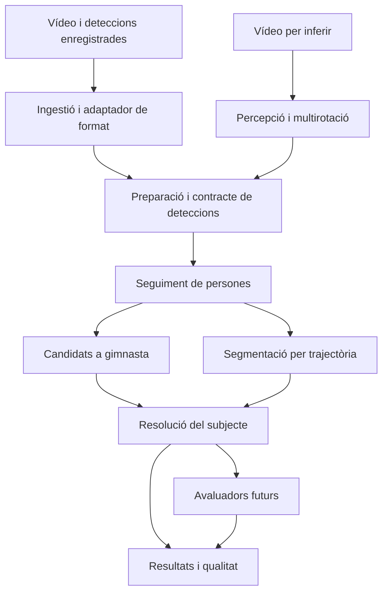

# 03. Arquitectura i dominis

## Organització adoptada

Un únic paquet Python amb dominis funcionals, contractes compartits, coordinació d'aplicació i
adaptadors d'infraestructura. Una carpeta no equival a un microservei. Inicialment l'anàlisi pot
córrer dins d'un procés de treball, evitant peticions de xarxa per persona i fotograma.

| Mòdul | És responsable de | No és responsable de |
| --- | --- | --- |
| `contracts` | Tipus, esquemes, invariants i versions compartits. | Llegir fitxers o executar models. |
| `ingestion` | Interpretar fonts, manifests i sincronització. | Assignar identitats. |
| `perception` | Executar backends visuals i orientacions. | Decidir la identitat temporal. |
| `preparation` | Validar, transformar i deduplicar deteccions. | Barrejar articulacions entre persones. |
| `tracking` | Associació, vida de trajectòries i recuperació. | Assignar notes esportives. |
| `subjects` | Candidats i selecció del gimnasta objectiu. | Substituir la identitat del tracker. |
| `segmentation` | Intervals i fases de salts sobre trajectòries. | Puntuar execució. |
| `scoring` | Avaluadors esportius versionats. | Llegir directament JSON OpenPose. |
| `quality` | Cobertura, ambigüitats i criteris d'ús. | Equiparar confiança del model amb probabilitat de nota correcta. |
| `results` | Construir representacions i exportacions dels resultats. | Recalcular assignacions. |
| `application` | Coordinar passos i casos d'ús. | Conèixer detalls HTTP o d'un motor de cues. |
| `interfaces` | CLI, API i entrada del procés de treball. | Contenir algoritmes de domini. |
| `infrastructure` | Persistència, cues, logs i artefactes. | Definir la semàntica d'un salt. |

## Dos recorreguts d'entrada

La configuració resol els components a l'inici. El recorregut enregistrat no carrega backends
visuals. El recorregut d'inferència produeix el mateix contracte i pot persistir-lo per reproduir
després el seguiment sense repetir el cost GPU.

## Regles de dependència

Els contractes no depenen de dominis ni de biblioteques de models. Els dominis consumeixen
contractes i interfícies petites; no importen servidors, cues, carpetes de dades ni scripts de TFM.
`application` coordina els dominis. Les interfícies criden casos d'ús; els adaptadors implementen
les necessitats d'entrada, sortida i execució. Les dependències opcionals s'importen en activar
el backend, no a `__init__.py`.

`quality` ha de poder calcular indicadors amb dades explícites, sense un estat global compartit.
`subjects` i `segmentation` no es criden mútuament: l'aplicació pot fer una primera selecció de
candidats, segmentar-los i resoldre el subjecte utilitzant les evidències obtingudes.

## Estat i temporalitat

L'estat del tracker pertany a un vídeo i a una execució. Es reinicia explícitament entre treballs.
Les instàncies no es comparteixen entre peticions. La línia temporal avança per fotogrames,
incloent-ne els buits; la diferència temporal arriba al tracker i al segmentador. La refinació
temporal de punts es fa dins d'una trajectòria identificada, preservant l'observació original.

## Fronteres pendents

La persistència concreta, el motor de cues, els trackers i els models no estan escollits.
Els futurs ports es definiran a partir del primer cas d'ús funcional, evitant abstraccions que
no tinguin encara un consumidor. El contracte de dades té prioritat sobre l'estructura de classes.
